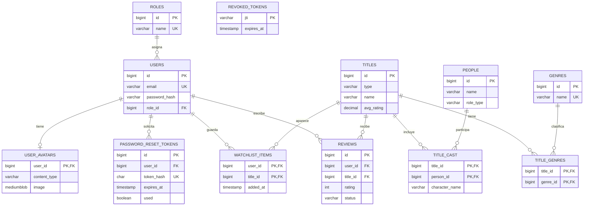

# BodrioPopcorn

Aplicación web para descubrir películas y series, consultar calificaciones y
compartir reseñas. Incluye catálogo, lista personal, perfil, moderación y
herramientas de administración.

## Equipo

- Jonathan de jesus Navarro Vazquez
- Maria Isabel Perez Cruz
- Juan Carlos Canseco Reyes

## Enlaces

- Sitio web: [https://bodriopopcorn.com](https://bodriopopcorn.com)
- URL base de la API: `https://bodriopopcorn.com/api`
- Repositorio: [ProgramacionWebFinal](https://github.com/KaiserWasTaken/ProgramacionWebFinal)
- Diseño: [BodrioPopcorn en Figma](https://www.figma.com/design/BbcNrviDKflzJCdqfdLNUh/BodrioPopcorn?node-id=0-1&t=9PGyPKeFbeDoiibR-1)

## Tecnologías

- Backend: Java 21, Spring Boot, Spring Security y JWT.
- Base de datos: MySQL 8, Spring Data JPA y Flyway.
- Frontend: React, Vite, React Router y Axios.
- Pruebas de API: Bruno.

## Requisitos

- JDK 21.
- Node.js y npm.
- MySQL 8.
- Bruno Desktop, opcional para probar la API.

## Configuración y ejecución local

1. Crea la base de datos en MySQL:

   ```sql
   CREATE DATABASE IF NOT EXISTS bodriopopcorn
     CHARACTER SET utf8mb4 COLLATE utf8mb4_unicode_ci;
   ```

2. Desde la raíz del proyecto, copia la configuración de ejemplo si todavía no
   tienes una configuración local:

   ```powershell
   if (-not (Test-Path ".\backend\src\main\resources\application.properties")) {
       Copy-Item ".\backend\src\main\resources\application.properties.example" ".\backend\src\main\resources\application.properties"
   }
   ```

3. En una terminal PowerShell, configura las variables del backend y ejecútalo:

   ```powershell
   cd backend
   $env:DB_USERNAME = "root"
   $env:DB_PASSWORD = [System.Net.NetworkCredential]::new("", (Read-Host "Contraseña de MySQL" -AsSecureString)).Password
   $bytes = New-Object byte[] 32
   $rng = [System.Security.Cryptography.RandomNumberGenerator]::Create()
   $rng.GetBytes($bytes)
   $rng.Dispose()
   $env:JWT_SECRET = [Convert]::ToBase64String($bytes)
   .\mvnw.cmd spring-boot:run
   ```

   La conexión predeterminada usa `localhost:3306` y la base `bodriopopcorn`.
   Si es diferente, define `DB_URL`. La clave generada es temporal: usa una
   clave privada persistente para evitar invalidar sesiones entre reinicios.
   No subas contraseñas ni claves al repositorio.

   Flyway crea y actualiza las tablas al arrancar; Hibernate valida el esquema.
   Crear la base de datos por sí solo no crea las tablas de la aplicación.

4. En otra terminal, desde la raíz del proyecto, inicia el frontend:

   ```powershell
   cd frontend
   npm.cmd ci
   npm.cmd run dev
   ```

   El backend escucha en `http://localhost:8089` y Vite muestra la dirección
   local del frontend en la terminal.

Las integraciones con Google, TMDB, correo, SMS y WhatsApp requieren sus
propias configuraciones y credenciales. Para Google, configura el mismo ID de
cliente web en `GOOGLE_CLIENT_ID` para el backend y `VITE_GOOGLE_CLIENT_ID`
para el frontend. Consulta la plantilla de configuración del backend.

## Despliegue

Las plantillas de `deployment/systemd/` y `deployment/nginx/` documentan el
servicio Java y el proxy del VPS. El JAR se ejecuta en `127.0.0.1:8089`,
Nginx sirve el frontend y redirige HTTP a HTTPS. MySQL debe permanecer accesible
solo localmente. El servicio carga su configuración privada desde
`/etc/bodriopopcorn/backend.env`; ese archivo y los certificados privados no
deben subirse al repositorio.

Para otro servidor, adapta las rutas y sustituye `__DOMAIN__` en la plantilla
Nginx. El certificado debe existir antes de habilitar la configuración HTTPS.
Revisa el JAR antes de desplegarlo: una compilación local puede incluir
`application.properties` con credenciales.

En el VPS, los siguientes comandos comprueban el servicio y la configuración:

```sh
systemctl is-active bodriopopcorn
systemctl is-enabled bodriopopcorn
sudo nginx -t
sudo ss -lnt
```

Que el servicio esté habilitado indica que está configurado para iniciar con el
sistema; para confirmar el arranque automático debe probarse un reinicio
coordinado del VPS.

## Cuentas de demostración

Flyway carga estas cuentas en una base nueva:

| Rol | Correo | Contraseña |
| --- | --- | --- |
| Administrador | `admin@bodriopopcorn.test` | `Demo123!` |
| Moderador | `moderator@bodriopopcorn.test` | `Demo123!` |
| Usuario | `user01@bodriopopcorn.test` | `Demo123!` |


## API y colección Bruno

La API local usa `http://localhost:8089/api`. Para rutas protegidas, envía el
JWT en el encabezado `Authorization: Bearer <token>`.

- `POST /api/auth/login`: inicia sesión y devuelve un token.
- `POST /api/auth/register`: registra un usuario.
- `GET /api/auth/me`: consulta la sesión actual.
- `GET /api/titles`: consulta el catálogo.
- `GET /api/watchlist`: consulta la lista del usuario.
- `GET /api/reviews/mine`: consulta las reseñas del usuario.

Para probar la API, inicia el backend, abre la carpeta `bruno` en Bruno Desktop,
selecciona el entorno `Local` y ejecuta las peticiones en orden. El login guarda
el token para las peticiones protegidas; también se prueban respuestas de error.

## Base de datos

Las migraciones están en `backend/src/main/resources/db/migration`. El respaldo
`database/backup.sql`, generado con `mysqldump`, contiene el esquema y datos de
demostración, no los datos de la base personal.

Para restaurarlo, crea primero una base vacía y, desde la raíz del proyecto,
ejecuta lo siguiente con el cliente `mysql` disponible en el PATH:

```powershell
cmd.exe /c "mysql -u root -p bodriopopcorn < database\backup.sql"
```

El respaldo incluye el historial de Flyway. No lo importes en una base con datos
que quieras conservar: el archivo reemplaza sus tablas.

El siguiente diagrama muestra las tablas principales y sus relaciones:



## Identidad visual

El diseño emplea azul principal `#103582` para la marca y acciones, azul claro
`#dcecff` para la navegación, y blanco `#ffffff` y gris claro `#f1f2f4` como
superficies neutras. El rojo `#b42318` distingue errores. Los azules mantienen
la identidad visual, mientras que los neutros favorecen la lectura y el rojo
se reserva para alertas.

El teléfono del perfil es opcional; si se proporciona, debe incluir `+`, código
de país y hasta 15 dígitos, sin espacios ni guiones. Esta validación no confirma
que el número exista o pertenezca al usuario.
